# 2024 Top-tier SCI Optimization! TTAO-CNN-BiGRU-MSA Triangular Topology Aggregation Optimization, Bidirectional GRU Fusion Attention for Multivariate Regression Prediction

Applicable Platform: MATLAB 2023 version and above
The TTOA triangulation topology aggregation optimization algorithm will be officially published in the top-tier SCI journal "Expert Systems with Applications" in January 2024.
This algorithm was proposed very recently, and there are currently no existing literature that applies this algorithm. With the New Year just beginning, seize it quickly!

We utilized this highly innovative optimization algorithm to optimize the hyperparameters in our CNN-BiGRU-Attention time-series and spatial feature combination - attention mechanism regression prediction program code. This resulted in the formation of the TTOA-CNN-BiGRU-MSA multivariable regression prediction model.
Literature Interpretation: The inspiration for this algorithm comes from the topological properties of triangles. The new mathematical heuristic algorithm named Triangulation Topology Aggregation Optimizer (TTAO) integrates each triangular topological unit as a search individual. The TTAO algorithm aggregates similar triangular topological units of different sizes to serve as the basic evolutionary units. Unlike other heuristic algorithms, TTAO introduces a novel evolutionary guidance mode, primarily relying on the best individual within each triangular unit to guide the evolution of individuals within the unit. Therefore, this evolved population not only relies on the excellent global guiding individuals but also absorbs the effective positive information from the best individual within each unit, which helps overcome the shortcomings of traditional methods entering local minima during global searches. Next, the article validated the TTAO algorithm's superior convergence performance through comparison with other algorithms: HHO; SCSO; SAO; BWO; AOA, etc. It was tested on CEC2017 functions and 8 engineering problems, demonstrating its optimization performance. Experimental results show that the TTAO algorithm has superior convergence and stability on the 30-dimensional CEC2017 function.
1. Principle: Many fields typically divide the objects of study into triangular topological units and establish related models for recognition and analysis, such as pyramids, triangle rulers, etc.
2. In finite or infinite-dimensional spaces, triangular topology can be considered as a subgraph of two-dimensional subspaces. Compared to other topologies, triangular topology is simpler and more stable in certain closed systems.
3. The TTAO algorithm mainly optimizes through the following two stages:
① Aggregation between different units
② Aggregation within similar triangular units
In this process, new vertices are continuously generated in the search space and used to construct different sizes of similar triangles. The TTAO algorithm treats each triangle as a basic evolutionary unit with four individuals, namely three vertices of the triangle and an internal random vertex. The core of aggregation is grouping together vertices with good characteristics. Specifically, the TTAO algorithm aggregates vertices with positive information collected from different topological units or internally, constantly building similar triangles.
4. Optimization steps:
The algorithm generates new vertices in the search space through iterative evolution to construct different sizes of similar triangles.
Each triangle is regarded as a basic evolutionary unit, containing four search individuals, namely three vertices of the triangle and an internal random vertex.
The core of the TTAO algorithm is aggregating vertices with superior characteristics. Specifically, the TTAO algorithm aggregates excellent individual information from different topological units to create new feasible solutions.
The algorithm realizes global search and local mining through three stages of update processes: generating triangular topological units, general aggregation, and local aggregation.
5. The innovative aspects of the constructed TTAO-CNN-BiGRU-MSA multivariate regression prediction model include:
TTAO algorithm's innovation compared to traditional intelligent algorithms:
1. Cellular Clustering Strategy: The TTAO algorithm employs a triangular topology unit expansion optimization process, with each triangular topology unit having a vertex, representing the search individual. This cellular clustering strategy enhances the TTAO algorithm's ability to mine both local and global information.
2. Two-Level Aggregation Strategy: The TTAO algorithm adopts a two-level aggregation strategy: general aggregation and local aggregation. General aggregation focuses on global exploration, finding more promising positions through the exchange of information between different triangular topology units; local aggregation ensures that information within each unit is effectively developed, ensuring accurate exploration of local areas.
3. Adaptive Strategy: The TTAO algorithm adaptively inherits the effective information from the previous generation, thus maintaining the diversity of the population. This adaptive strategy enables the TTAO algorithm to quickly converge to the global optimal solution.
4. Individual-Guided Evolution Strategy: The TTAO algorithm introduces a new key individual-guided evolution strategy, allowing the algorithm not only to rely on the global guidance evolution of elite individuals but also to absorb the positive and forward information from the best individual in each unit.
Optimization Application—Based on Triangular Topology Aggregation Optimization Algorithm (TTAO), Convolutional Neural Network (CNN) and Bidirectional Gated Recurrent Unit (BiGRU) fusion attention mechanism (Multi-Head Self Attention, MSA):
\n        \n      Functions:
1. Multivariate feature input, single sequence variable output, inputting the features of one day before, achieving prediction for the next day, with a 24-step ahead prediction.
2. Optimize learning rate, convolution kernel size, number of neurons through the TTAO optimization algorithm, aiming to minimize MAPE as the objective function.
3. Provide loss and RMSE iterative change polar coordinates graph; network feature visualization graph; test comparison graph; fitness curve (if the initial precision is highest, then the fitness curve will be a horizontal line).
4. Provide MAPE, RMSE, MAE, etc. for calculation results display.
Applicable fields: Wind speed prediction, photovoltaic power prediction, power generation forecasting, carbon price prediction, and other applications.
Dataset format:
- 18 meteorological features the day before, sampling time is 24 hours, output is the power output of the next day, which is 18×24 input, 1×24 output, there are a total of 75 such samples.
Prediction value vs actual value comparison; training feature visualization:
- Training error curve in polar coordinates (error gradually approaching zero from inside to outside); fitness curve (error gradually decreasing)
Error assessment:
- TTAO core code part:

## Images

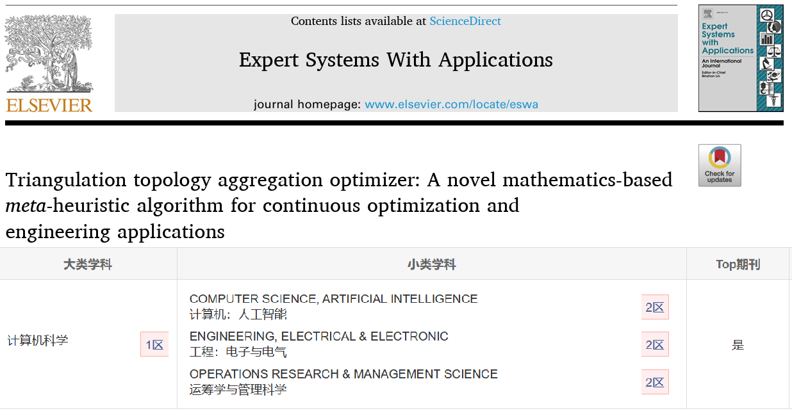
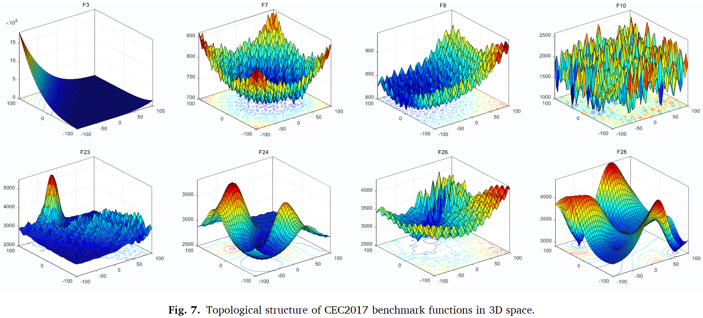
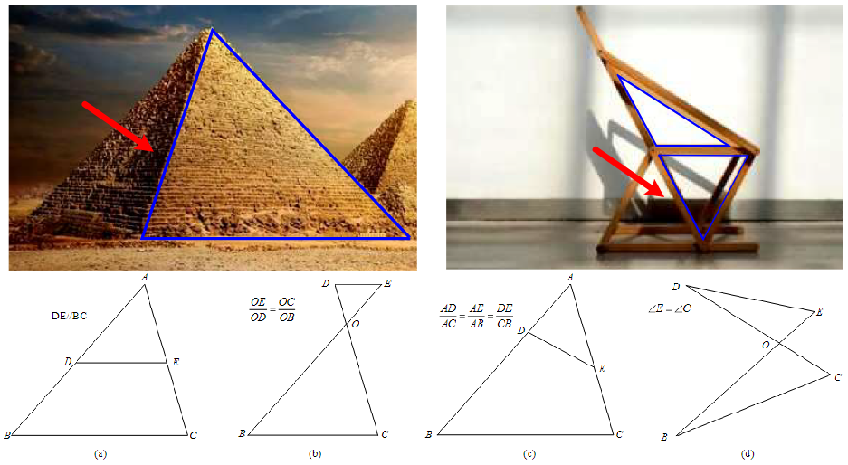
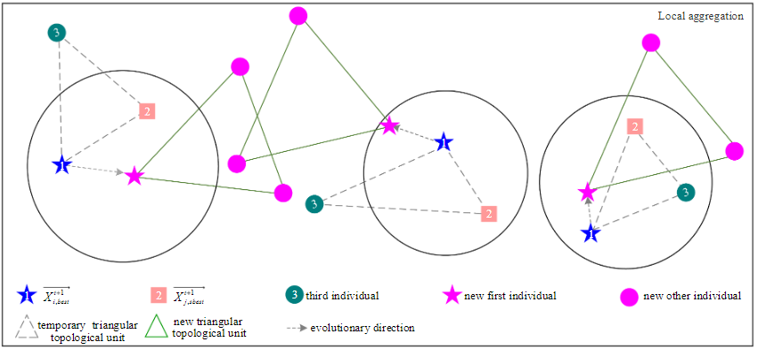
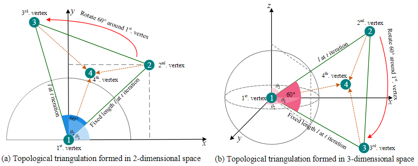
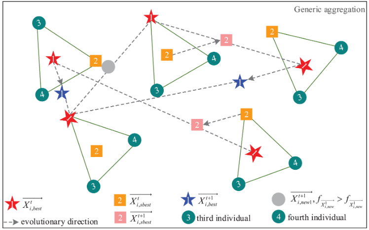
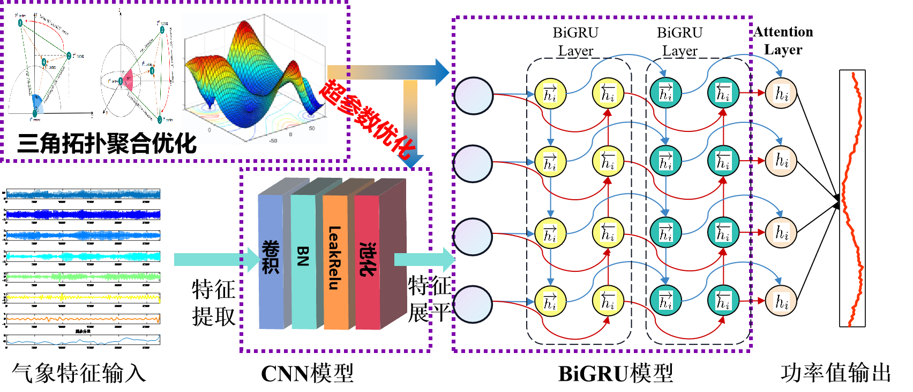

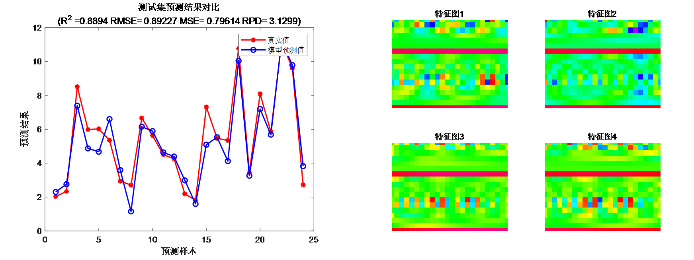
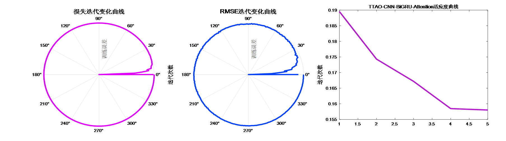
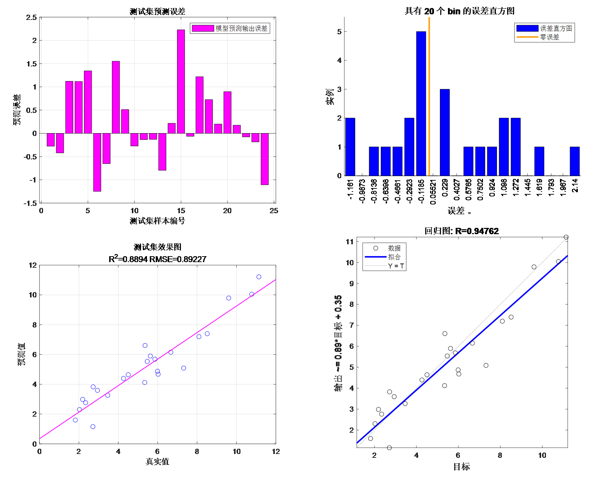
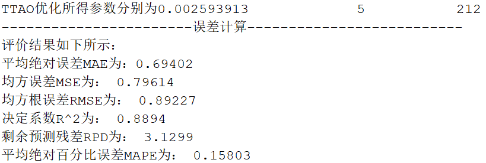

<!-- PAYMENT_BLOCK -->

## Get this dataset

- Payment link (Stripe): [Buy now](https://buy.stripe.com/3cs8yP7sY87d0vu9AB)
- Payment QR code: 

<!-- /PAYMENT_BLOCK -->
